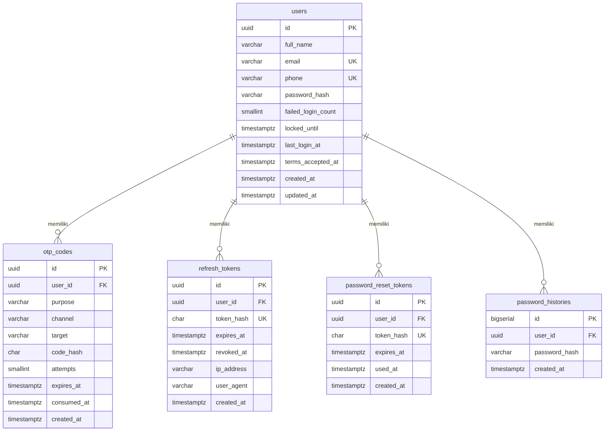

# Dokumen Database — Amanah Auth (PostgreSQL 16)

## 1. ERD

## 2. Struktur tabel

| Tabel | Fungsi | Dipakai oleh flow |
|---|---|---|
| `users` | Akun. Menyimpan hash password (bcrypt), counter gagal login, dan waktu kunci akun. | Register, Login Email, Login WA, Lupa Password |
| `otp_codes` | OTP 6 digit. Yang disimpan hanya HMAC-SHA256 dari kode, bukan kode asli. | Login WA, Lupa Password |
| `refresh_tokens` | Sesi login. Yang disimpan hanya SHA-256 dari token. | Semua flow yang menghasilkan login |
| `password_reset_tokens` | Token sekali pakai setelah OTP reset diverifikasi (layar "Atur Kata Sandi Baru"). | Lupa Password |
| `password_histories` | Riwayat hash password, supaya kata sandi baru tidak boleh sama dengan yang lama. | Register, Lupa Password |

Kolom lengkap beserta tipenya ada di `migrations/001_init.sql`.

## 3. Relasi

Semua relasi 1:N dari `users` dan memakai `ON DELETE CASCADE`: hapus user, maka OTP, sesi, token reset, dan riwayat password ikut terhapus.

## 4. Constraint

| Tabel | Constraint | Tujuan |
|---|---|---|
| users | `uq_users_email`, `uq_users_phone` | Satu email / satu nomor WA hanya untuk satu akun (error "Sudah Terdaftar" di layar Register) |
| users | `ck_users_email_lower` | Email selalu huruf kecil, mencegah duplikat `Budi@x.com` vs `budi@x.com` |
| users | `ck_users_phone_e164` | Nomor wajib format internasional `+62...` |
| users | `ck_users_failed_count` | Counter tidak boleh negatif |
| otp_codes | `ck_otp_purpose`, `ck_otp_channel` | Hanya nilai yang dikenal |
| otp_codes | `ck_otp_expiry` | `expires_at > created_at` |
| otp_codes | `uq_otp_active` (partial unique index) | Hanya 1 OTP aktif per (target, purpose) |
| refresh_tokens / password_reset_tokens | `uq_*_token_hash` | Token tidak boleh kembar |

## 5. Index

| Index | Tabel | Untuk query |
|---|---|---|
| `uq_users_email`, `uq_users_phone` | users | Login & cek duplikat (lookup by email / phone) |
| `idx_otp_latest (target, purpose, created_at DESC)` | otp_codes | Ambil OTP terakhir saat verifikasi dan cek cooldown kirim ulang |
| `uq_otp_active` | otp_codes | Menjamin 1 OTP aktif |
| `idx_otp_user_id`, `idx_reset_user_id` | otp_codes, password_reset_tokens | Join / cascade delete |
| `idx_refresh_user_active` (partial, `revoked_at IS NULL`) | refresh_tokens | Cabut semua sesi user |
| `uq_refresh_token_hash` | refresh_tokens | Lookup saat refresh token |
| `idx_*_expires_at` | otp_codes, refresh_tokens, password_reset_tokens | Job pembersihan data kedaluwarsa |
| `idx_pwhist_user_created (user_id, created_at DESC)` | password_histories | Ambil N password terakhir |

## 6. Aturan bisnis yang ditegakkan di DB

- Counter gagal login diperbarui **atomik** dalam satu `UPDATE ... CASE`, jadi aman dari race condition.
- `ResetPassword` berjalan dalam **satu transaksi**: token ditandai terpakai, password diganti, riwayat ditulis, semua sesi dicabut.
- OTP di-consume dengan `UPDATE ... WHERE consumed_at IS NULL`, sehingga tidak bisa dipakai dua kali walau ada request paralel.
